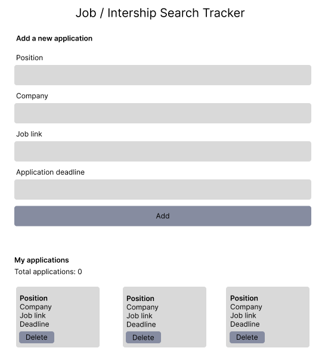
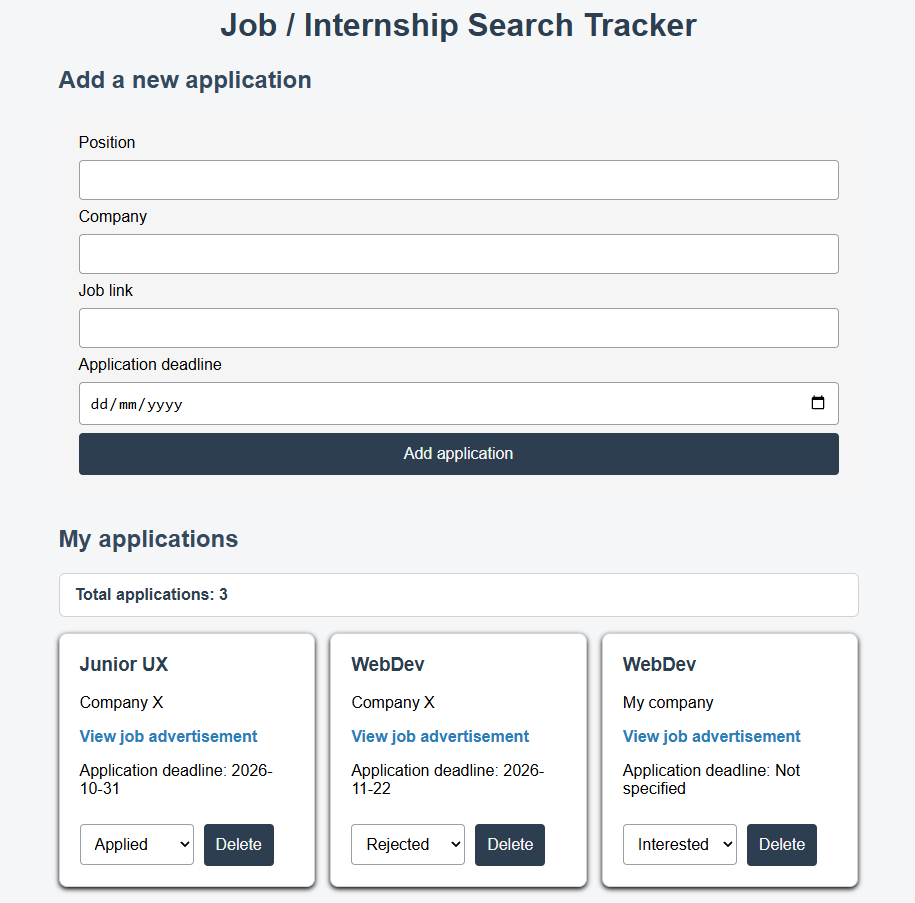

# Job Search Tracker

**Author:** Alexandra Manieva

## Project plan

### Project idea

Job search tracker is a web application for people who are looking for a job or internship. It helps users save interesting job advertisements and track their application progress in one place.

### Planned features

- Add job vacancies with position, company, job link and application deadline.
- Track application status and update it when the application process changes.
- Remove vacancies that are no longer relevant.
- Save vacancies in the browser using localStorage.

### Wireframe

## Web links

- **[Published application](https://alluxman.github.io/Job-search-tracker/)**
- **[GitHub repository](https://github.com/alluxman/Job-search-tracker.git)**
- **[Project video presentation](https://video.laurea.fi/media/Job-search-tracker%20project%20overview/0_x7zq6dwy)**

## About the application

**Job search tracker** allows users to collect job vacancies in one place and manage their job applications. Users can add vacancy details, update application statuses, set deadlines and remove vacancies that are no longer relevant. The application saves the data in the browser using localStorage.

## Technologies

- HTML – page structure
- CSS – styling and layout
- JavaScript – functionality, DOM scripting and form validation
- localStorage – saving data in the browser

## How to use the application

1. Open the application using the published link.
2. Enter the position, company and job link. You can also add an application deadline.
3. Click **Add application** to add the vacancy to your list.
4. Change the application status using the *dropdown* menu.
5. Click **Delete** to remove an application from the list.
6. Refresh the page to check thet your applications are still saved.

## Running the application locally

1. Clone or download **[this repository](https://github.com/alluxman/Job-search-tracker.git)** to your computer.
2. Open the *Job-search-tracker* -project folder.
3. Open `index.html` in a web browser.
The application uses local storage to save application data in the browser.

## Screenshots

## Known issues / limitations

- **Application data is stored in the browser using local storage. It is not syncronized across devices or browsers.**
- **Clearing the browser's local storage may delete saved applications.**

## Self-assessment and learning reflection

During this project, I learned how to combine HTML, CSS and JavaScript to create a working web application. I practised DOM scripting, form validation, event listeners and saving data with localStorage.

One of the challenges was understanding how different parts of JavaScript works together. I also learned more about using CSS to improve layout and appearance of the application.

If I had more time, I would improve the design and add more features.

This project helped me understand how to build a simple web application and practice the skills learned during the course.

## Sources and acknowledgements

- [Web Development 1 course materials](https://juho-kastemaa.gitbook.io/web-development-1)
- [Figma](https://www.figma.com/) used to create the wireframe.
- AI tool used: *ChatGPT*
  - ChatGPT helped me understand JavaScript and CSS, troubleshoot code, improve the application layout and prepare the README. I tested the changes in my own project
